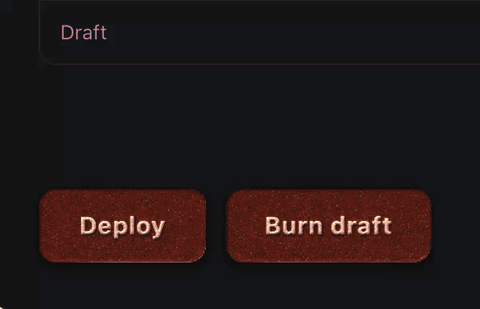
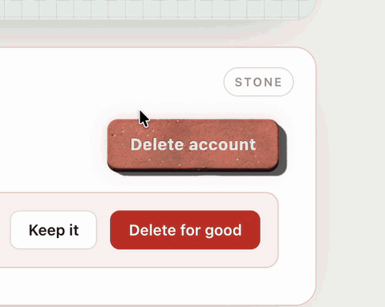

# Elemental buttons

A set of JavaScript effects that each turn an ordinary HTML `<button>` into a different material: water, fire, stone, sand, soap film, ice, glass or porcelain. The button stays a real control, so focus, keyboard, form submission and click handlers keep working. The effect is drawn on a transparent WebGL canvas laid over the page.


The water button being pressed. It pops into droplets and reforms a moment later.

This is a collection of prototypes and demos, not a finished library. There is no package and no build step.

## Quick start

Each effect is one classic script in `fx/`, so the pages also work when opened from `file://`.

```html
<button id="cta">Get started</button>

<script src="fx/water.js"></script>
<script>
  const fx = ElementalFX.attachWater(document.querySelector('#cta'));
  // later: fx.detach() restores the original button
</script>
```

The other effects are attached the same way: `attachFire`, `attachRock`, `attachSand`, `attachBubble`, `attachIce`, `attachGlass`, `attachCeramic`. The second argument is an options object. All eight scripts can be loaded on one page; `elements.html` does that.

## Effects

| File | Looks like | Demo to open |
| --- | --- | --- |
| `fx/water.js` | A pill of water. Pressing dents it, releasing pops it into droplets that can be dragged and merged. | `water-demo.html` |
| `fx/fire.js` | A match-striker strip. A click lights a flame while an action is pending. It can also burn the strip away and regrow it. | `fire-demo.html` |
| `fx/rock.js` | A stone slab with the label carved in. A click cracks it into chunks you can throw. | `rock-demo.html` |
| `fx/sand.js` | A block of damp sand. Pressing leaves a fingerprint, dragging carves grooves. | `sand.html` |
| `fx/bubble.js` | A soap bubble in the button's shape. Releasing pops it. | `bubble-demo.html` |
| `fx/ice.js` | A slab of ice with light snowfall. A click breaks it into chunks, and clicking a chunk crushes it. | `ice-demo.html` |
| `fx/glass.js` | A pane of thick glass. A click shatters it and the shards fall onto a ledge. | `glass-demo.html` |
| `fx/ceramic.js` | A glazed tile. It shatters, then the shards fit back together with gold seams. | `ceramic-demo.html` |

`elements.html` (titled "Fieldwork") shows all of them on real buttons in one page. `index.html` is a page for the water button alone.





## Options

The header comment at the top of each file lists every option for that effect. A few that come up often:

- `zIndex`: z-index of the overlay canvas (default 10).
- `sound`: most effects make sound by default. Pass `sound: false` to silence them. `sand.js` has no such option.
- `surface`: in water, ice and glass, an image of what is behind the button, so the material can refract it.
- `material` (rock), `glaze` (ceramic), `tint` (glass): choose the look.

## Requirements

All eight effects need WebGL2. Four of them also need float render targets (the `EXT_color_buffer_float` extension), which the source checks for:

| WebGL2 and `EXT_color_buffer_float` | WebGL2 only |
| --- | --- |
| water, fire, rock, sand | bubble, ice, glass, ceramic |

No browser or device list is given because none has been tested systematically.

## How it works

Each script puts a canvas over the button and draws the material with WebGL2 shaders. The real `<button>` stays in the DOM and receives the clicks. The fire effect, for example, is a 2D fluid simulation, per its header comment.

## Limitations

- If WebGL2, or the float extension where it is required, is missing, the effect does nothing and the button is left as it was. The attach call returns a stub object (`supported: false` in the files that were checked), and `detach()` is safe to call on it.
- Each attached button adds a canvas and a render loop. The cost of many buttons on one page has not been measured.
- The code has only been exercised through the demo pages in this repo.
