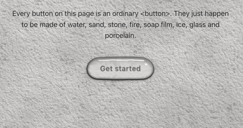

# Elemental buttons

Drop-in effects that turn an ordinary `<button>` into water, sand, rock, fire, soap film, ice, glass or porcelain. The button stays a real control: focus, keyboard, form submission and click handlers are untouched. The effect is drawn on a transparent canvas laid over the page.



## Usage

```html
<script src="fx/water.js"></script>
<script>
  const fx = ElementalFX.attachWater(document.querySelector('#cta'));
  // fx.detach() restores the original button
</script>
```

Each effect lives in `fx/` as a single classic script, so pages also work from `file://`. Options for each effect are documented in the header comment of its file.

## Effects

| File | Material |
| --- | --- |
| `fx/water.js` | Water pill with droplets |
| `fx/sand.js` | Sand |
| `fx/rock.js` | Stone |
| `fx/fire.js` | Fire |
| `fx/bubble.js` | Soap film |
| `fx/ice.js` | Ice |
| `fx/glass.js` | Glass |
| `fx/ceramic.js` | Porcelain |

`elements.html` shows all of them on one page. The per-effect `*-demo.html` files are standalone examples.

## Requirements

WebGL2 with float render targets. If it is unavailable, the button is left as it is.
